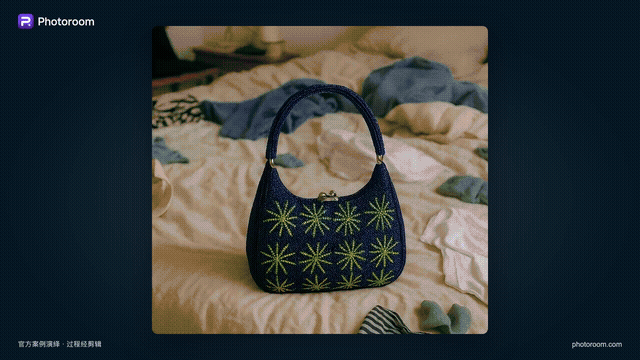
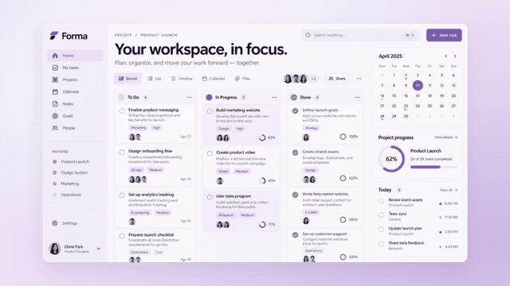

# Launch Video Maker

**English** | [简体中文](README.zh-CN.md)

**Turn your product into a launch film.**

An agent skill for Claude Code and Codex that turns websites, screenshots, recordings, and product briefs into editable product videos. Explore three visual directions, shape the story, then refine the film through playback and feedback.

[Gallery](#gallery) · [Install](#install) · [How to use](#how-to-use) · [How it works](#how-it-works) · [Content](#content)

## Gallery

Made with launch-video-maker · Unofficial concept demos.

<!-- Looping GIF previews: Photoroom 00:00–00:10; Canva 00:06–00:24;
     TapVid 00:18–00:23; Product Launch Lavender 00:16–00:31.
     Click each preview to open the GIF at full size. -->

<table>
  <tr>
    <td width="50%" align="center">
      <a href="docs/assets/gallery/photoroom-promo.gif"></a>
      <br><strong>Photoroom</strong>
    </td>
    <td width="50%" align="center">
      <a href="docs/assets/gallery/canva-launch.gif"></a>
      <br><strong>Canva</strong>
    </td>
  </tr>
  <tr>
    <td width="50%" align="center">
      <a href="docs/assets/gallery/tapvid-launch.gif"></a>
      <br><strong>TapVid</strong>
    </td>
    <td width="50%" align="center">
      <a href="docs/assets/gallery/product-launch-lavender.gif"></a>
      <br><strong>Product Launch Lavender</strong>
    </td>
  </tr>
</table>

## Install

Built and tuned for Claude Code and Codex. The simplest way is to hand your agent the link:

```text
Install this skill for me: https://github.com/SigmaMatrix-AI/launch-video-maker
Check my environment, install the required tools and dependencies,
and verify that the skill is ready to use.
```

Your agent handles setup and guides you through any steps that need your input.


## How to use

```text
Use launch-video-maker to create a product launch video for https://your-product.com.
```

## How it works

Agree on the direction and story before spending time and tokens on detailed animation.

| Step | What the agent creates | What you decide |
| --- | --- | --- |
| **1. Choose the look** | Three distinct style frames using the same representative content, with a recommendation. | The visual direction: typography, color, composition, and overall tone. |
| **2. Shape the story** | A story script and rough storyboard that make the message and sequence clear. | What the video says, what it shows, and in what order. |
| **3. Refine the film** | A playable video, iterated through UI refinement, transitions, pacing, typography, and sound. | Whether the film communicates clearly and feels right in motion. |

Before designing, the agent explores the product beyond the homepage hero: relevant sections, feature pages, demos, and real interfaces. It gathers usable material and connects each proposed claim to product evidence.

The storyboard in step 2 can stay rough. Precise timing, camera movement, and polished UI belong in step 3, once the content is settled. A feature tour, a single-feature announcement, and a continuous product walkthrough are all valid stories.

During refinement, the focus is on what changes **over time**:

- **Motion with breathing room.** Mix quick actions, larger reveals, and quiet holds so important moments have room to land.
- **Typography that carries the story.** Give key statements their own shots. Reveal phrases, replace a keyword, shift emphasis, or carry text into the product interaction it introduces.
- **Continuity between shots.** Let an object, shape, or action connect one moment to the next.
- **Decisions based on playback.** Review movement, reading time, and sound in context. Attractive stills and passing technical checks are only part of the review.

Template projects follow their own adaptation guides, preserving the agreed composition, motion, and pacing. They do not require the three-direction exploration used for original designs.

## Under the hood

Films are built with **React and TypeScript**, rendered through **Playwright**, and encoded with **FFmpeg**. The same scene source, assets, frame timing, and audio mix drive the preview and export.

You keep the film source, local assets, and production notes. The browser player supports playback, scrubbing, and frame stepping; the CLI supports still capture, MP4 export, and review evidence collection.

To open an existing film project, run this from its directory:

```bash
npm run preview -- --open
```

To export and inspect a version:

```bash
npm run render -- launch.mp4
npm run inspect -- launch.mp4
```

Rendering refuses to overwrite an existing output file. After editing source or assets, restart the preview to load the new version.

## Content

```text
launch-video-maker/
├── SKILL.md                       # Agent instructions and production routes
├── references/                    # Production guides
│   ├── pipeline.md                # Three-stage workflow
│   ├── stage-deliverables.md      # Deliverables, approvals, and continuation
│   ├── product-research.md        # Website exploration and product evidence
│   ├── motion-language.md         # Pacing and typography
│   ├── eval.md                    # Visual examples and Good / Bad criteria
│   ├── tech.md                    # Rendering, media, audio, and review tools
│   ├── runtime-setup.md           # Setup instructions for agents and developers
│   └── template-conventions.md    # Template adaptation
├── examples/motion-language/      # Five runnable Good / Bad comparisons
├── templates/                     # Reusable film projects
├── styles/                        # Visual style references
├── runtime/                       # Local video runtime
│   ├── src/                       # Rendering, media, audio, and CLI
│   ├── web/                       # Browser preview player
│   └── test/                      # Runtime tests
└── docs/                          # Design notes, plans, and validation records
```

Available templates: [Product Launch Lavender](templates/product-launch-lavender/template.md), [Motion Design Promo](templates/motion-design-promo/template.md), and [Capsule Flow](templates/capsule-flow/template.md). Visual style references live in [`styles/`](styles/).


## License

[Apache-2.0](LICENSE).

Third-party dependencies and bundled reference media, fonts, and brand assets retain their own licenses and usage restrictions. See the source and license notes included with each asset or template.
