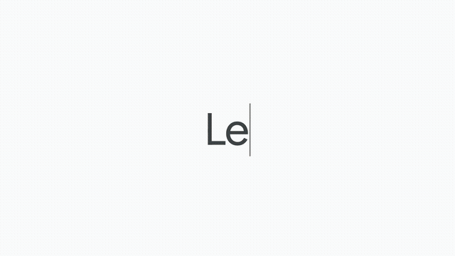
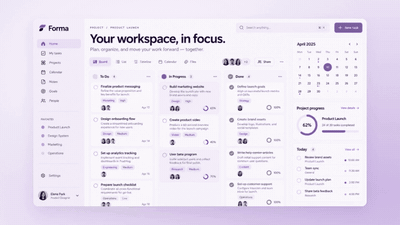

<p align="center">
  <strong>English</strong> | <a href="README.zh-CN.md">中文</a>
</p>

<h1 align="center">Launch Video Maker</h1>

<p align="center"><strong>One prompt. A launch video for your product.</strong></p>

<p align="center">
  An agent skill for Claude Code and Codex that turns websites, screenshots, recordings, and product briefs into editable product videos. Explore three visual directions, shape the story, then refine the film through playback and feedback.
</p>

<p align="center">
  <a href="#gallery">Gallery</a> · <a href="#install">Install</a> · <a href="#how-to-use">How to use</a> · <a href="#how-it-works">How it works</a> · <a href="#content">Content</a>
</p>

## Gallery

Made with launch-video-maker · Unofficial concept demos.

<!-- Looping GIF previews: Photoroom 00:00–00:10; Canva 00:06–00:24;
     TapVid 00:18–00:23; Product Launch Lavender 00:16–00:31.
     Lightweight previews: 400×225 at 15 fps.
     Click each preview to open the GIF on its own. -->

<p align="center">
  <a href="assets/gallery/photoroom-promo.gif"></a>
  <a href="assets/gallery/canva-launch.gif"></a>
</p>

<p align="center">
  <a href="assets/gallery/tapvid-launch.gif"></a>
  <a href="assets/gallery/product-launch-lavender.gif"></a>
</p>

## Install

Built and tuned for Claude Code and Codex. The simplest way is to hand your agent the link:

```text
Install this skill for me: https://github.com/SigmaMatrix-AI/launch-video-maker
Check my environment, install the required tools and dependencies,
and verify that the skill is ready to use.
```

Your agent handles setup and guides you through any steps that need your input.

## How to use

```text
Use launch-video-maker to create a product launch video for https://your-product.com.
```

## How it works

Agree on the direction and story before spending time and tokens on detailed animation.

1. **Choose the look.** Explore three distinct style frames using the same representative content, with a recommendation. Choose the typography, color, composition, and overall tone.
2. **Shape the story.** Review a story script and rough storyboard. Decide what the video says, what it shows, and in what order.
3. **Refine the film.** Develop a playable video, refining the UI, transitions, pacing, typography, and sound through playback and your feedback.

## Under the hood

Films are built with **React and TypeScript**, rendered through **Playwright**, and encoded with **FFmpeg**. The same scene source, assets, frame timing, and audio mix drive the preview and export.

You keep the film source, local assets, and production notes. The browser player supports playback, scrubbing, and frame stepping; the CLI supports still capture, MP4 export, and review evidence collection.

## Content

```text
launch-video-maker/
├── SKILL.md                       # Agent instructions and production routes
├── references/                    # Production guides
│   ├── pipeline.md                # Three-stage workflow
│   ├── stage-deliverables.md      # Deliverables, approvals, and continuation
│   ├── product-research.md        # Website exploration and product evidence
│   ├── motion-language.md         # Pacing and typography
│   ├── eval.md                    # Visual examples and Good / Bad criteria
│   ├── tech.md                    # Rendering, media, audio, and review tools
│   ├── runtime-setup.md           # Setup instructions for agents and developers
│   └── template-conventions.md    # Template adaptation
├── assets/                        # Documentation images
│   ├── gallery/                   # Demo GIF previews and source records
│   ├── motion/                    # Motion sequences and extraction records
│   ├── references/                # Composition references and storyboards
│   └── tapvid-cta.svg              # README CTA banner
├── examples/motion-language/      # Five runnable Good / Bad comparisons
├── templates/                     # Reusable film projects
├── styles/                        # Visual style references
├── runtime/                       # Local video runtime
│   ├── src/                       # Rendering, media, audio, and CLI
│   ├── web/                       # Browser preview player
│   └── test/                      # Runtime tests
└── docs/                          # Validation guide and font license metadata
```

Available templates: [Product Launch Lavender](templates/product-launch-lavender/template.md), [Motion Design Promo](templates/motion-design-promo/template.md), and [Capsule Flow](templates/capsule-flow/template.md). Visual style references live in [`styles/`](styles/).

<p align="center">
  <a href="https://tapvid.ai?utm_source=launch-video-skill"></a>
</p>

## License

Project-authored code and documentation are licensed under [Apache-2.0](LICENSE).

Third-party software, fonts, demo media, music, and brand assets retain their own terms. See [Third-party notices](THIRD_PARTY_NOTICES.md) for sources, bundled font licenses, and permissions still requiring confirmation. Inclusion in this repository does not make those assets Apache-licensed or freely redistributable.
